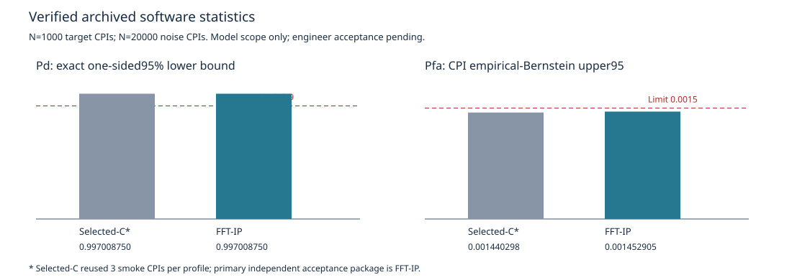

# S04 statistical evidence review, 2026-11-14 local date

Reviewer disposition: **scoped model-level statistical PASS verified; recommend engineer acceptance of the FFT-IP model campaigns**. This is an evidence review, not a new Gate decision. Original STARTED/RAW/RESULT files and historical decisions are unmodified.

## Independent numerical assessment

| Path | Metric | Independent sample | Recalculated result | Criterion | Assessment |
|---|---|---:|---|---|---|
| Historical Selected-C | Pd | 1,000 CPI | D=1,000; exact one-sided95% L=0.9970087504549047 | L>=.90 | Numerical PASS; smoke reuse caveat |
| Historical Selected-C | Pfa | 20,000 CPI | 55,429 alarms; mean=.0009962077641984183; EB U=.0014402981113345271 | U<=.0015 | Numerical PASS; smoke reuse caveat |
| FFT-IP bit-accurate model | Pd | 1,000 CPI | D=1,000; exact one-sided95% L=0.9970087504549047 | L>=.90 | PASS in declared model population |
| FFT-IP bit-accurate model | Pfa | 20,000 CPI | 56,122 alarms; mean=.0010086628324946082; EB U=.001452904715042641 | U<=.0015 | PASS in declared model population |

For all four complete RAW archives: exact expected count, contiguous index0..N-1, unique input hashes, RAW SHA matching RESULT, current source hashes matching STARTED, 2,782 CUTs per CPI, zero reported input clips/internal events. Pfa was independently recalculated using math.fsum sample variance and the frozen CPI-level empirical-Bernstein formula. Pd was independently recalculated by exact Clopper-Pearson; R/V/J are recorded separately and all1,000 in each software Pd archive. Their counts do not create a separate approved joint acceptance criterion. Full details and hashes are in the companion JSON.

Scope: raw IQ33x128, Q1.15 admission, g5 CN(0,1) noise-only for Pfa; g1, amplitude.18, target range40/Doppler+4, SNR20dB, no clutter for Pd. Frozen FFT shifts, alpha, masks and association rules apply. No multi-target/off-bin/clutter/general physical detection claim is inferred.

## Code and history findings

1. Selected-C source, complete logs and results are committed in04a89c6. FFT-IP model/start records are in9453857, finalizer in9279f3b, complete results in2f47e31. Board runner is in1fea780. Git retained all historical files.
2. Fixed counts, no threshold adjustment, no top-up and stop/invalidate on exceptions/clips/overflows are implemented in software runners. Correct integer-native CFAR is used; Pfa sampling unit is the independent CPI, not each correlated cell.
3. **Selected-C preflight reuse:** three first smoke IQ hashes in each profile match final indices0/1/2. Do not describe that campaign as wholly unseen acceptance data. No retuning is established by this overlap; the sampling and calculations remain as observed. Use the separately seeded FFT-IP campaign as the primary scoped S04 acceptance package. This is a historical finding, not permission to replace samples or rerun.
4. Software RAW preserves source IQ hashes, counts and Pd flags, not full IQ/Power/intermediate arrays. Source generators/seeds/numeric files are preserved. Full sample-by-sample software output comparison cannot be performed solely from these RAW summaries without authorized replay. No new replay was run here.
5. STARTED source hashes are verified, but initial referenced Git commit can predate addition of the test file; runner/addition commits and explicit file hashes must accompany the baseline. Existing file/library identities are checked, not independently authenticated execution history.
6. The finalizer checks line counts and RAW hash, but does not independently establish acceptance and does not check that the staged index contains only its named files. No unrelated finalizer commit content was found in2f47e31. Do not treat finalizer completion as engineering approval.
7. Intervening other-chat dialogue is incomplete in canonical Replay. The current user-pasted transcript remains source context with its original ellipsis, not a fabricated complete conversation. Existing uncommitted conversation content is preserved.

## Running hardware campaign

A read-only snapshot verified118 completed Pd CPIs, all118 D/R/V/J successes, with complete IQ/Power/journal file hashes, NPZ input equality and independent CFAR alarm recount. These are interim observations; fixed plannedN remains1,000. No RESULT existed at review snapshot; Pfa20,000 had not started. No UART connection, programming, restart, source change or live-data rewrite was performed by this review.

The board runner archives full input IQ, actual FPGA Power and actual final records; requires verified input, COMMIT and RELEASE; compares actual records to C05 on actual Power; stops rather than replaces an invalid CPI. It uses separately seeded hardware profiles.

**Important limits:** its Pfa counts are host-side C05 decisions reconstructed from actual FPGA Power, not direct downloaded RTL CFAR-mask bits. Record equality checks support correspondence in observed data, but cannot prove every unobserved internal mask bit. Its internal_events=0 field is hardcoded; hardware overflow was not read. It is invalid to cite that field as proof of zero hardware overflow. A local bitstream-file hash is not loaded-SRAM readback attestation. MF/MTI/FFT intermediate maps are not archived by this runner. Preserve execution; report these limitations separately, without changing the running script.

## Current disposition and next stage

The earlier statement OPEN_NOT_EXECUTED is now a historical snapshot superseded by completed model-level evidence, not a source file to rewrite. Current view: **FFT-IP model Pd/Pfa PASS verified, engineer acceptance pending; full implementation equivalence/hardware acceptance remains pending**. Do not erase the broader performance/overflow/population limitations or automatically close any Gate.

S04 was already closed with carryovers and S05 authorized in S04-C08-S05-TRANSITION-001. It is appropriate to continue documentation/evidence review of S05 while the hardware campaign continues. S05 final Gate still requires owner acceptance of the as-built architecture/interfaces. The first review package is S05-REVIEW-ENTRY-20261114.md.

Protection: all1,361 main-entry file hashes and all2,961 Lab-entry file hashes match; main/Lab HEAD unchanged. All original tracked main baseline files in this audit worktree match except authorized append-only Replay. No protected implementation changed in this review.
